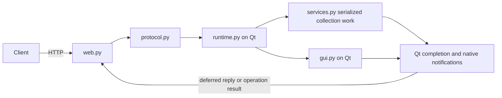

# Anki-Connect architecture

Anki-Connect runs inside Anki Desktop 2.1.15 or later. It serves JSON-RPC 2.0 at
`POST /api/v1` and the legacy action protocol at every other path, on `127.0.0.1:8765` by
default. The canonical contract is [API_V1.md](API_V1.md) and
[api-v1.schema.json](api-v1.schema.json). The legacy API still reports version 6.

| Module | Responsibility |
| --- | --- |
| `plugin/__init__.py` | Version gate, startup, settings, permissions, exact legacy signatures, and asynchronous legacy dispatch. |
| `plugin/web.py` | Nonblocking sockets, path routing, strict JSON, HTTP limits, CORS, authentication, and deferred replies. |
| `plugin/protocol.py` | Schema validation, typed errors, callback completion, operation records and cancellation. |
| `plugin/runtime.py` | Qt admission, collection/session pins, serialized native work, completion notifications, ordered commands and tokens/cursors. |
| `plugin/services.py` | Native collection, scheduler, note-type, preset, media, package, statistics and undo services. |
| `plugin/gui.py` | Browser, editor, reviewer, import, profile and sync adapters on Qt's main thread. |
| `plugin/legacy.py` | Argument translation, result projection, compatibility failures and attachment orchestration. |
| `plugin/media.py` | Request-owned media backups, rollback and interrupted-request recovery. |
| `plugin/contract.py` | Generated bundled schema and legacy target map. |
| `plugin/edit.py` | Custom note editor and session-local history. |
| `plugin/compat.py` | Versioning layer: differences between Anki releases behind stable helpers. |

## Supporting Anki releases

Services and adapters call `plugin/compat.py` instead of branching on Anki versions.
It prefers feature detection (attributes, signatures, hooks) and uses release
numbers only for behavior that cannot be probed without side effects, such as
reviewer callback signatures or native races fixed in a later release. Missing
features are reported as capabilities: `runtime.py` maps methods to native paths
and `compat.FEATURES`, so `api.describe` lists the reason and calls fail with
`unsupportedCapability` rather than emulating absent Anki behavior. Hooks that a
release lacks are skipped without fake substitutes.

`tools/anki_matrix.json` lists every Anki GitHub release from 2.1.15 with pinned
dependencies; `tools/update_anki_matrix.py` regenerates it. `tools/anki_env.py`
prepares each environment from PyPI wheels, or for releases before 2.1.24 from the
official Linux bundle. Python 3.6 (2.1.15) and Python 3.7 (2.1.24) on Linux come from
pinned conda-forge locks in `tools/`.

## Execution and completion

Add-on startup registers the custom editor and unload hooks, opens optional
API logging, and starts a retained Qt timer. Importing as `plugin` in tests
skips automatic startup. The timer advances socket reads/writes without blocking
on API completion. Each connection closes after its reply drains.

After the listener starts, Anki-Connect uses Anki's macOS helper to suppress App
Nap for the process lifetime, including profile switches. The native helper
retains the activity token and allows idle system sleep. Other platforms skip
suppression. A helper failure is reported to the console without stopping the
listener.

Admission captures the active collection and opaque session on Qt's main thread.
GUI operations stay there. Collection tasks use Anki's task manager with its
serialized collection access and background-operation lifecycle counter. File
reads/downloads use background tasks without collection access. Completion callbacks
publish native changes through `on_op_finished` before resolving API replies.
Failed operations also publish changes from successful prefixes.

Completed methods reply after work and native notifications. Interactive/long
methods return operation handles; poll `operations.get` for final results.
`api.execute` waits for each final outcome and continues after item errors.
Cancellation between commands preserves completed outcomes in error details.
Running work is cancellable only where a native cancellation callback is wired.
Disconnecting a socket does not cancel accepted work.

Legacy standalone GUI actions preserve accepted-return timing where documented.
Legacy `multi` waits for each final outcome, including nested batches. It preflights
the full request tree for malformed containers, nesting depth and final exit
ordering. Neither command form creates a transaction across items. Exit begins
only after outstanding socket replies drain.
Legacy batches preserve unbounded action counts for whole-vault Obsidian syncs.
Request bodies are limited to 128 MiB at the legacy endpoint, which fits base64
media up to the 64 MiB media limit, and 16 MiB at `/api/v1`. Each poll reads
available bytes in bulk. The v1 batch count limit is separate.
Legacy envelopes and arguments are normalized before admission guards: harmless
surplus parameters, null optional defaults, decimal strings, boolean spellings,
and single-item lists are handled at the compatibility boundary. Note fields,
tags, and attachment targets share legacy normalization across creation and writes.
V1 schemas remain strict; authentication and batch preflight rules are unchanged.

## Sessions and editor coordination

Sessions change on collection identity changes, profile unload, temporary collection
close/full sync and adapter-controlled reopen. Tokens, cursors, editor registrations
and custom editor history are invalidated. Collection calls pin their admission
session and recheck it before execution; lifecycle transitions reject competing work.
Queued GUI calls recheck active collection work when they start. Legacy requests
wait up to 30 seconds for lifecycle work, reserved from the admission of a legacy
`sync` or `loadProfile` until it finishes, and legacy GUI actions also wait for
active collection work, matching historical synchronous ordering. Standalone legacy
`sync` replies after the sync finishes.

Affected open editors conservatively block writes, including clean/saved editors
and potentially pending webview changes. Close affected editors to proceed. Legacy
note-type writes conflict only when field edits change a note type shown in an
editor; template, styling, and card scheduling writes are not blocked by editors.
Because change notifications reload open editors, legacy writes first ask each
open editor to save through `call_after_note_saved` and recheck admission. Add
drafts have explicit update methods and reject content replacement/type changes
when a draft already contains unsaved content. This release does not claim fully
synchronized dirty-state detection for every editor variant.

## Native writes and media

Services use native note-type conversion, deck moves, scheduler states/answers and
coordinated preset update requests. Atomic bulk note creation preflights before a
native bulk transaction; ordinary bulk work returns independent item outcomes.
Undo support is declared per method; grouped undo is distinct from atomicity.
Advanced history import is an explicit database transaction, clears undo and
requests native cache/window refresh. Template usage uses an adapter mirroring
Anki's token grammar because the parsed tree is not exposed to Python.

Media acquisition finishes before replacement. Replacement writes use a journal
outside the media directory, backing up originals before native trash/write.
Failure restores request-owned files; ownership conflicts preserve unrelated
changes and retain the journal for recovery. Recovery runs before a session's
first collection work and before each media transaction. A journal that cannot be
restored is renamed with an `.unresolved` suffix: its backups are kept for manual
inspection, it is never reapplied, and it does not block later requests.
Legacy note attachments use the same
journal around collection changes. Database and filesystem writes do not share
an atomic transaction. Recovery conservatively keeps media referenced by notes
when interruption makes collection commit status uncertain.

## Access, configuration and validation

Existing settings and default fallbacks remain in `plugin/config.json` and
`plugin/util.py`. Legacy requests use body `key`; v1 uses Bearer authentication.
Permission methods alone bypass key checks and receive origin context from the
transport. Origin filtering and authentication are independent. v1 logs contain
method/ID/timing/error metadata, excluding credentials and note/media bodies. Legacy
logs keep the historical full request/reply entries with `key` redacted.

`api.describe` reports adapter presence and checked native dependencies. Availability
is a capability probe, not proof of integration testing; method-specific state and
unsupported subfeatures can still produce explicit errors.

`tests_api/` is the default suite and uses disposable native collections, with
controlled Qt admission for ordering tests. Client request flows cover Yomitan,
Obsidian_to_Anki, LunaTranslator, asbplayer, GameSentenceMiner (GSM) and Jiten.
Real GUI checks require a working
display and temporary profiles; sync requires a disposable test account. Run `make test` to execute unit tests and all GUI scenarios for both protocols against
the latest Anki version listed in `tools/test.sh`, using isolated cached environments.
On Windows, `.\tools\test.ps1` uses the same default in PowerShell.
Use `make test TEST_ARGS=--all-versions` or `.\tools\test.ps1 -AllVersions` to run the full matrix.
Use `make test-unit` (PowerShell: `-NoUI`) to skip GUI scenarios when a display is unavailable.
The public references are [API v1](API_V1.md) and [legacy API](API_LEGACY.md).
The [coverage inventory](API_TEST_COVERAGE.md) distinguishes direct service,
controlled admission, and real GUI evidence for each public method. Both test
runners validate its registry coverage and source references; known testing gaps
are explicitly listed and remain work to do.

`tools/build_api_contract.py` bundles the source contract, including the
`x-legacyTargets` registry used for legacy capability checks. Use `--check` to
verify generated output without writing files. `make package` runs `tools/package.sh`
and the Python ZIP builder, `tools/package_addon.py`, without cleaning the checkout.
