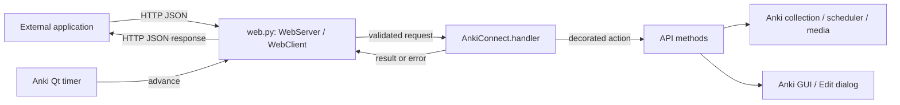

# Anki-Connect architecture

## What the add-on does

Anki-Connect bridges external applications and a running Anki Desktop instance.
It exposes JSON actions for searching, creating, updating, and deleting notes;
inspecting and scheduling cards; managing decks and note types (called models
in the API); storing media; reading and inserting review history; importing and
exporting packages; switching profiles and syncing; and operating Anki's browser,
editor, and reviewer. The full action reference is in [README.md](README.md).

A note stores fields and tags. Its model defines fields, card templates, and CSS;
Anki generates cards from those templates. Cards belong to decks and carry
scheduling state. The add-on works with these objects in Anki's active profile,
using Anki's collection, scheduler, database, media manager, and GUI APIs.
Persistence remains in Anki's collection database and media directory.

## Components

| File | Responsibility |
| --- | --- |
| `plugin/__init__.py` | Anki version check, startup, `AnkiConnect`, action dispatch, and action implementations. |
| `plugin/web.py` | `WebServer`, per-connection `WebClient` buffers, HTTP parsing, origin checks, JSON validation, and serialization. |
| `plugin/util.py` | `@api` metadata, default settings, media downloads, rendering and Python/Anki compatibility helpers. |
| `plugin/edit.py` | Registered custom edit dialog, session note history, browser history search, and card preview/navigation. |
| `plugin/config.json` | User-visible default add-on configuration. Additional defaults live in `util.DEFAULT_CONFIG`. |
| `tests/conftest.py` | Temporary Anki sessions/profiles, test data, event-loop helpers, and test-specific patches. |
| `tests/test_*.py` | Action-category, GUI/editor, and HTTP integration tests. |

## Startup and execution model

Importing the plugin first parses `aqt.appVersion` and rejects versions below
23.10.0. When loaded under Anki's add-on package name (including
`AnkiConnectDev`), it registers the custom `Edit` dialog, constructs a global
`AnkiConnect` instance, opens optional logging, and starts the HTTP listener.
Importing it as `plugin`, as the tests do, skips that automatic startup.

`AnkiConnect.startWebServer()` binds the listener and creates a retained `QTimer`.
At the default 25 ms interval, the timer calls `advance()`, which accepts clients
and advances their reads and writes through `select`. API handlers run on Anki's
Qt main thread, so they can access collection and GUI state directly. There is
no separate API worker pool. Socket reads and synchronous actions, including
downloads, can delay UI processing.

## Request lifecycle and compatibility

1. `WebClient` buffers an HTTP request until its headers and `Content-Length`
   body are available. It sends the reply and closes the connection after the
   write buffer is drained.
2. `WebServer.handlerWrapper()` checks the origin and handles `OPTIONS`
   preflight requests. It decodes UTF-8 JSON and validates the top-level schema:
   a nonempty string `action` is required; `version` must be an integer and
   `params` an object when supplied. Action-specific argument validation happens
   in the dispatcher or action itself.
3. An allowed empty-body request returns an API banner. Malformed allowed
   requests return a JSON error. Disallowed origins receive HTTP 403, except
   that `requestPermission` may proceed to the permission flow.
4. `AnkiConnect.handler()` defaults omitted `version` to 4 and `params` to `{}`.
   It checks the request's `key` against the configured API key, except for
   `requestPermission`, then finds an instance method marked by `@util.api()`.
   The decorator can specify versioned names; dispatch selects the latest
   applicable name for the requested version. Arguments are passed as keywords.
5. Successful version 5+ actions return `{"result": value, "error": null}`.
   Success at version 4 or lower returns just the result. Exceptions currently
   return `{"result": null, "error": message}` at every version. Most API errors
   use HTTP 200; clients must inspect the JSON error field.

The `version` action reports 6 by default. `multi` invokes the dispatcher for
each supplied request and returns their replies in order; it does not establish
a transaction across the actions.

## Collection mutations, media, and editing

API methods resolve services through `aqt.mw`, with helpers that raise when a
collection or required service is unavailable. Many writes call `startEditing()`
to mark Anki's UI as requiring a reset. Actions use a mix of Anki object APIs,
GUI operations, and direct database queries; reset and persistence behavior
must be assessed per action.

Note creation resolves an existing model and deck, populates fields and tags,
adds media, and checks empty/duplicate constraints. Duplicate checking supports
options for deck scope, child decks, and other models. `addNote` asks Anki to
generate cards and returns the note ID. This checkout's `addNotes` attempts every
item, gathers errors, and deletes successfully added notes if any item fails,
then raises an aggregate error. This is compensating cleanup, not a database
transaction; media written during those attempts can remain. `updateNote`
updates fields before tags and does not roll back fields if tag updates fail.

Media can come from base64 data, a local path, or a URL. `storeMediaFile` uses
Anki's media manager and can skip content matching an MD5 hash. Note media
helpers insert image or sound references into fields. Retrieval returns base64
data, and deletion uses Anki's media trash operation. URL downloads use Anki's
HTTP client and the configured download timeout.

`guiEditNote` opens the custom `Edit` dialog. It maintains an in-memory note
history, supports previous/next navigation and card preview, and provides a
browser search for that history. Anki hooks reload changed notes and remove
invalid history entries; dialog cleanup removes its lifecycle hooks.

## Configuration and access control

Settings come from Anki's add-on manager, with per-key fallbacks in
`util.DEFAULT_CONFIG`. The default listener is `127.0.0.1:8765`, the socket
backlog is 5, logging is disabled, and `apiKey` is null. Binding changes require
restarting the listener, normally by restarting Anki. Environment variables
`ANKICONNECT_BIND_ADDRESS` and `ANKICONNECT_CORS_ORIGIN` supply fallback defaults;
explicit add-on configuration takes precedence.

`webCorsOriginList` defaults to `http://localhost`. Origin checking also permits
selected loopback and browser-extension origins under that default, and permits
requests without an `Origin` header. `*` allows every origin. The deprecated
`webCorsOrigin` setting is still supported. Origin filtering and API key
authentication are separate checks.

`requestPermission` receives the actual origin and allowed status from the
transport. For an unapproved origin it can show an Anki permission dialog and
persist either approval in `webCorsOriginList` or suppression of further prompts
in `ignoreOriginList`. API key checking is bypassed for this action so clients
can discover permission and whether a key is required.

When enabled, `apiLogPath` is opened in write mode at startup and records full
dispatcher requests and replies, including request keys and note content.

## Development and verification

`link.sh` installs a development symlink into an existing Linux or macOS Anki
add-ons directory. `package.sh` runs `git clean -xdf` before packaging `plugin/*`
into `AnkiConnect.zip` with `7za`; that cleanup deletes untracked and ignored
files and should be reviewed before use.

Tests launch real Anki/Qt sessions with temporary profiles. Most action tests
call `AnkiConnect` directly; `tests/test_server.py` launches Anki in a separate
process and verifies actual HTTP requests, serialization, malformed input, and
origin rejection. Editor tests exercise dialogs and web-view interaction.
Fixtures patch background tasks to complete on the main thread for ordinary
action tests, so those tests do not fully reproduce production asynchronous
timing. See [AGENTS.md](AGENTS.md) for dependencies and test commands.
